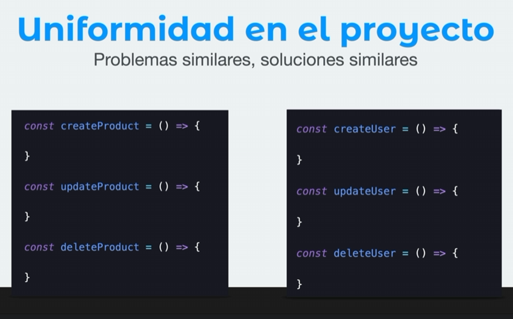
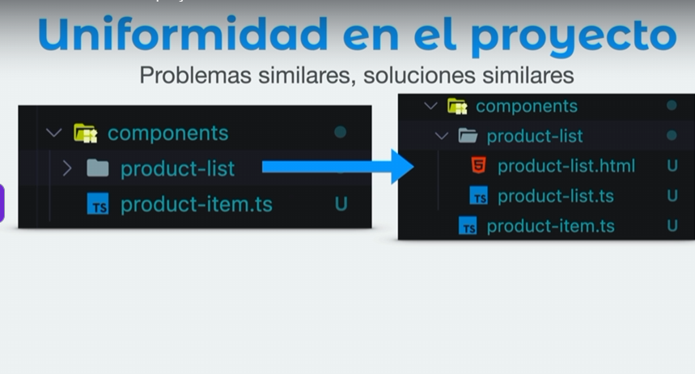
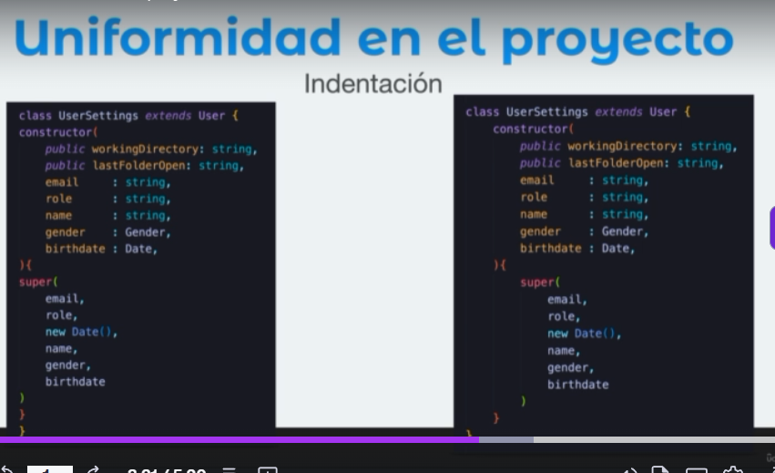

# Clases y comentarios

## Principio de responsabilidad única (SRP)

El principio de responsabilidad única establece que una clase o módulo debe tener un único motivo para cambiar. Esto significa que debe encargarse de una responsabilidad bien delimitada, en lugar de reunir tareas que pertenecen a distintas partes del sistema.

Por ejemplo, una clase `User` puede encargarse de los datos y el comportamiento propios de un usuario, mientras que las preferencias de la aplicación pueden vivir en una clase `Settings`. Así, un cambio en la configuración no obliga a modificar la clase que representa al usuario.

El objetivo no es crear una clase por cada método, sino agrupar lo que cambia por la misma razón y separar responsabilidades independientes. Esto facilita entender, mantener y probar el código.

## Comentarios

El código debe ser suficientemente claro y expresivo para explicar por sí mismo qué hace. Por eso, los comentarios deberían ser la excepción y no la regla: un comentario que repite lo que ya expresa el código puede quedar desactualizado y añadir ruido.

Un comentario sí puede ser útil cuando explica una decisión o una limitación que no resulta evidente, por ejemplo, una particularidad de una librería de terceros, una API o un framework. En esos casos, conviene explicar el motivo y el contexto, en vez de describir línea por línea lo que el código ya muestra.

Antes de agregar un comentario, considera si puedes hacer el código más claro mediante mejores nombres, funciones más pequeñas o una estructura más sencilla. Evita usar comentarios para justificar soluciones improvisadas o complejas cuando el diseño puede mejorarse.

## Uniformidad en el proyecto

Para problemas similares, utiliza soluciones similares. La consistencia en nombres, formato, estructura e indentación ayuda a que el proyecto se lea como un conjunto y reduce el esfuerzo necesario para comprender cada archivo.

