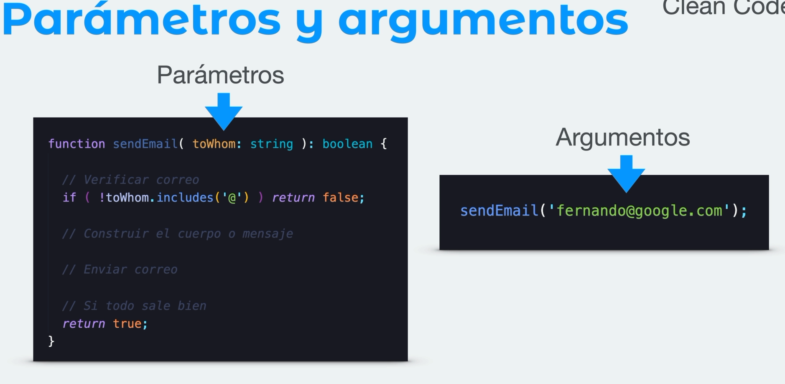
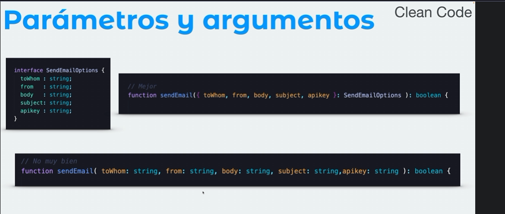

# Clean Code y deuda técnica

## ¿Qué es la deuda técnica?

La deuda técnica es el costo futuro que se genera al elegir una solución que facilita el trabajo inmediato, pero hace más difícil mantener o evolucionar el software. Puede asumirse de forma consciente o aparecer sin que el equipo la advierta. No toda deuda es necesariamente irresponsable: a veces una decisión temporal es razonable, siempre que se conozca y se gestione.

Por ejemplo, se puede posponer una refactorización para cumplir una fecha de entrega. Si esa decisión queda sin seguimiento, los cambios futuros pueden requerir más tiempo y esfuerzo.

### Cuadrantes de la deuda técnica

La clasificación de Martin Fowler combina dos preguntas: ¿la deuda fue deliberada o inadvertida?, y ¿la decisión fue prudente o imprudente?

| Tipo | Descripción |
| --- | --- |
| Prudente y deliberada | Se conoce una solución mejor, pero se elige una alternativa temporal por una razón válida y se registra el trabajo pendiente. |
| Imprudente y deliberada | Se conoce el riesgo, pero se toma el atajo sin un plan razonable para asumir o reducir sus consecuencias. |
| Prudente e inadvertida | La deuda se descubre después, a pesar de que se tomaron decisiones razonables con el conocimiento disponible. |
| Imprudente e inadvertida | La deuda aparece porque no se comprendieron prácticas o soluciones importantes que podrían haberse considerado. |

La deuda técnica acumula intereses: cuanto más depende el sistema de una decisión difícil de cambiar, más costoso puede resultar cada cambio posterior.

### ¿Cómo reducirla?

La **refactorización** mejora la estructura interna del código sin cambiar su comportamiento observable. Las pruebas automáticas ayudan a comprobar que ese comportamiento se mantiene durante la refactorización. También es útil registrar la deuda conocida y priorizarla junto con el trabajo del producto.

## ¿Qué es Clean Code?

Clean Code es código cuya intención resulta clara para las personas que deben leerlo, mantenerlo y modificarlo. Nombres expresivos, funciones acotadas y una estructura coherente ayudan a lograrlo.

### Nombres pronunciables y expresivos

Los nombres deben comunicar qué representa cada elemento y facilitar la conversación sobre el código.

| Nombre poco claro | Nombre más expresivo |
| --- | --- |
| `n` | `numberOfUnits` |
| `tx` | `tax` |
| `cat` | `category` |
| `ddmmyyyy` | `birthDate` |

### Parámetros y argumentos

Apuntes visuales sobre parámetros y argumentos:

Apuntes sobre el orden de los argumentos y buenas prácticas al llamar a una función:

### Simplicidad de las funciones

- Mantén cada función enfocada en una tarea y fácil de entender.
- Una función corta es útil si su intención sigue siendo clara; la longitud por sí sola no es el objetivo.
- Considera salidas tempranas cuando eviten niveles innecesarios de anidamiento.

### Principio DRY (*Don't Repeat Yourself*)

DRY busca evitar duplicar conocimiento o reglas del sistema. Cuando una misma lógica aparece en varios lugares, centralizarla puede facilitar cambios y pruebas. Antes de extraer código, verifica que las repeticiones representan realmente la misma regla; abstraer prematuramente también puede dificultar el mantenimiento.

## Material del curso

[Repositorio de la sección 2 — Clean Code y deuda técnica](https://github.com/Klerith/clean-course/tree/fin-seccion-02)
